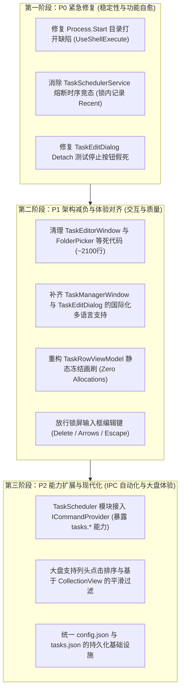

# CarroDesk 全面架构与代码审查报告（2026-11-09）

> **审查基准**：master @ `4a2b7fb`（feat(task-scheduler): split PID/uptime columns, yes-no flags, add memory column）  
> **审查范围**：宿主核心（Host / Core / Common / Services）、全部 8 个业务模块（ScreenLock, TaskScheduler, Awake, AudioSwitch, AppAutoMute, MonitorProfile, ClipboardHistory, ServiceControl）、CLI 命令行与 MCP 适配器（cli/CarroDesk.Cli）、构建发布体系（scripts/）与单元测试套件（tests/），共计约 8.9 万行（含 XAML）。  
> **审查维度**：工程架构、代码质量、界面与人机交互、易用性与开发者体验。

---

## 一、总体评价与执行摘要

CarroDesk 是一个设计周密、工程规范度高的 Windows 桌面自动化常驻管家。项目在基础建设上有诸多优秀实践：
- **生命周期清晰**：基于 [ModuleBase.cs](file:///c:/Home/Projects/CarroDesk/src/Core/ModuleBase.cs) 的标准化状态机，启停逆序清理、安全隔离调用（`SafeInvoker`）与跨模块解耦；
- **IPC 安全内核严谨**：命名管道基于 Windows SID 的显式 DACL 隔离、请求校验链（存在性→模块态→参数 Schema→口令防爆破→限流→超时取消）设计具备工业级水准；
- **系统底层协作扎实**：利用 Windows 作业对象（Job Object）兜底子进程回收、低级键盘钩子防御、DDC/CI 异步防抖调光以及系统闲时服务（`SystemIdleService`）的 64 位原子时间戳同步。

然而，经历从 .NET 4.8 升级至 .NET 10、多轮模块重构（如近期任务管理器大盘重构、Batch-2 字段扩充）之后，代码库中累积了若干**平台升级遗留的静默功能失效**、**跨线程观测时序竞态**、**重构遗留的大体积死代码**，以及**新视图与全局国际化（i18n）架构严重断层**等现实问题。

---

## 二、问题汇总清单

| 编号 | 类别 | 级别 | 所在模块/位置 | 简述 |
|---|---|---|---|---|
| **E1** | 代码质量/易用性 | **高危** | [HostMenuActions.cs#L77](file:///c:/Home/Projects/CarroDesk/src/Host/Services/HostMenuActions.cs#L77), [ConfigEditorWindow.xaml.cs#L117](file:///c:/Home/Projects/CarroDesk/src/Views/ConfigEditorWindow.xaml.cs#L117) | .NET 10 下 `Process.Start(dir)` 缺失 `UseShellExecute=true`，托盘与配置窗口的"打开配置目录"100%静默失败 |
| **E2** | 代码质量/测试 | **高危** | [TaskSchedulerService.cs#L904-L911](file:///c:/Home/Projects/CarroDesk/src/Modules/TaskScheduler/Services/TaskSchedulerService.cs#L904-L911) | 守护熔断状态标记与 `AddRecent("marked")` 跨锁时序倒错，测试偶发断言失败（已实测复现） |
| **E3** | 人机交互/易用性 | **高危** | [TaskEditDialog.xaml.cs#L364-L407](file:///c:/Home/Projects/CarroDesk/src/Modules/TaskScheduler/Views/TaskEditDialog.xaml.cs#L364-L407) | Detach 任务测试运行时 `finally` 瞬间折叠"停止"按钮，脱管常驻测试进程无法在界面终止 |
| **A1** | 工程架构/维护性 | **中危** | [TaskEditorWindow.xaml.cs](file:///c:/Home/Projects/CarroDesk/src/Modules/TaskScheduler/Views/TaskEditorWindow.xaml.cs), [FolderPicker.cs](file:///c:/Home/Projects/CarroDesk/src/Common/FolderPicker.cs) | 存在约 1,900 行完全废弃的旧编辑器死代码，伴随已淘汰的 Win32 COM `FolderPicker` |
| **A2** | 工程架构/生态 | **中危** | [TaskSchedulerModule.cs](file:///c:/Home/Projects/CarroDesk/src/Modules/TaskScheduler/TaskSchedulerModule.cs) 等 | IPC 能力开放不均：核心自动化任务（`tasks.*`）、屏幕锁定（`screenlock.*`）未实现 `ICommandProvider` |
| **A3** | 工程架构/持久化 | **中危** | [TaskConfigService.cs#L365-L572](file:///c:/Home/Projects/CarroDesk/src/Modules/TaskScheduler/Services/TaskConfigService.cs#L365-L572) | `tasks.json` 手写序列化与解析逻辑，缺乏单一事实来源（SSOT），新增配置字段极易遗漏 |
| **U1** | 界面交互/i18n | **中危** | [TaskManagerWindow.xaml](file:///c:/Home/Projects/CarroDesk/src/Modules/TaskScheduler/Views/TaskManagerWindow.xaml), [TaskEditDialog.xaml](file:///c:/Home/Projects/CarroDesk/src/Modules/TaskScheduler/Views/TaskEditDialog.xaml) | 重构后的任务管理大盘与编辑弹窗 100% 硬编码中文，英文环境下界面严重撕裂 |
| **U2** | 界面交互/性能 | **中危** | [TaskManagerWindow.xaml.cs#L568-L756](file:///c:/Home/Projects/CarroDesk/src/Modules/TaskScheduler/Views/TaskManagerWindow.xaml.cs#L568-L756) | `TaskRowViewModel` 属性 Getter 高频无条件 `new SolidColorBrush` 与颜色字符串反序列化，加剧 GC 压力 |
| **U3** | 人机交互/易用性 | **低危** | [KeyboardBlocker.cs#L85-L97](file:///c:/Home/Projects/CarroDesk/src/Modules/ScreenLock/Services/KeyboardBlocker.cs#L85-L97) | 锁屏键盘钩子过度吞键：PIN 输入框中方向键、Delete、Escape、Home/End 均被阻断 |
| **U4** | 易用性/交互 | **低危** | [TaskManagerWindow.xaml](file:///c:/Home/Projects/CarroDesk/src/Modules/TaskScheduler/Views/TaskManagerWindow.xaml) | 大盘 10 列均不支持点击列头排序（如按内存大小、运行状态倒序排），且搜索采用清空列表模式 |
| **C1** | 代码质量/并发 | **低危** | [AwakeService.cs#L196,L485](file:///c:/Home/Projects/CarroDesk/src/Modules/Awake/Services/AwakeService.cs#L196) | `_pendingFireAt` 64位结构体跨线程读写无内存屏障，多核体系下存在弱内存模型可见性隐患 |
| **D1** | 开发者体验/文档 | **低危** | [README.md#L42](file:///c:/Home/Projects/CarroDesk/README.md#L42), [scripts/release.py#L9](file:///c:/Home/Projects/CarroDesk/scripts/release.py#L9) | 发布说明陈旧：README 仍提示安装 NSIS，而脚本与工程早已全面迁移至 Inno Setup 6+ |

---

## 三、重点问题深入剖析与代码实证

### 1. [高危-Bug] E1. .NET 10 平台下 `Process.Start(dir)` 导致"打开配置目录"完全失效

- **涉及位置**：
  - [HostMenuActions.cs#L73-L80](file:///c:/Home/Projects/CarroDesk/src/Host/Services/HostMenuActions.cs#L73-L80)
  - [ConfigEditorWindow.xaml.cs#L111-L120](file:///c:/Home/Projects/CarroDesk/src/Views/ConfigEditorWindow.xaml.cs#L111-L120)
- **代码事实**：
  ```csharp
  // HostMenuActions.cs
  public static void OpenConfigDirectory()
  {
      try
      {
          Process.Start(ConfigService.DirPath); // 传入目录路径
      }
      catch { }
  }
  ```
- **机理分析**：
  在项目从 .NET Framework 4.8 升级至 .NET 10（commit `7298bd7`）后，`Process.Start(string)` 的内部行为发生了破坏性变化：.NET Framework 下 `UseShellExecute` 默认为 `true`，Windows Shell 会自动调用资源管理器打开该目录；而现代 .NET（Core 2.0+ / .NET 5+ / .NET 10）中，`UseShellExecute` 默认改为 `false`，此时底层走 `CreateProcessW`，直接将目录路径作为可执行文件加载，必然抛出 `Win32Exception: 拒绝访问` 或 `找不到指定文件`。
  外层的 `catch { }` 将该异常静默吞掉，导致用户在托盘右键点击"打开配置目录"或在设置界面点击按钮时**毫无反应**。
  *(注：在 [TaskManagerWindow.xaml.cs#L479](file:///c:/Home/Projects/CarroDesk/src/Modules/TaskScheduler/Views/TaskManagerWindow.xaml.cs#L479) 中，开发者已显式传入了 `new ProcessStartInfo { FileName = ..., UseShellExecute = true }`，印证了此处的遗漏)*。
- **改进建议**：
  统一封装 `ProcessHelper.OpenFolder(string folderPath)`，显式配置 `UseShellExecute = true`。

---

### 2. [高危-时序竞态] E2. 守护熔断状态发布与 Recent 列表写入时序倒错引发测试失败

- **涉及位置**：
  - [TaskSchedulerService.cs#L889-L914](file:///c:/Home/Projects/CarroDesk/src/Modules/TaskScheduler/Services/TaskSchedulerService.cs#L889-L914)
  - [TaskPersistentRunTests.cs#L536-L542](file:///c:/Home/Projects/CarroDesk/tests/CarroDesk.Tests/TaskPersistentRunTests.cs#L536-L542)
- **实测证据**：
  执行全套 `dotnet test` 时，`Supervise_RestartsUntilMarked_ManualRunResets` 偶发失败：
  ```
  失败 Supervise_RestartsUntilMarked_ManualRunResets [2 s]
  错误消息: Assert.IsTrue 失败。recent 列表应记录熔断标记
  堆栈跟踪: at CarroDesk.Tests.TaskPersistentRunTests.Supervise_RestartsUntilMarked_ManualRunResets()
  ```
- **机理分析**：
  审阅 `HandleDetachFailure` 发现：
  ```csharp
  if (newState == TaskRuntimeState.MarkedFailed)
  {
      lock (_lock)
      {
          ...
          sup.MarkedFailed = true; // 1. 锁内发布状态
          sup.MarkedAt = DateTime.Now;
      }
      RemoveSlot(task.Name, slot);
      TaskLogger.Error(...);       // 2. 耗时的日志与格式化
      AddRecent(task.Name, "marked"); // 3. 此时才记录到 _recent
      return;
  }
  ```
  测试代码使用 `WaitUntil(() => scheduler.GetSupervision(name).MarkedFailed)` 等待熔断。一旦步骤 1 完成，测试线程立即被唤醒并直接断言 `scheduler.GetRecent()[0].Contains("marked")`；但此时工作线程正阻塞在 `RemoveSlot` 或 `TaskLogger.Error` 的 I/O 阶段，`AddRecent` 尚未执行，`GetRecent()` 顶部依然是上次崩溃的 `fail:7`，断言立即失败。
- **改进建议**：
  将 `AddRecent(task.Name, "marked")` 移至锁内或紧随 `MarkedFailed = true` 之后，确保状态对外可见时，关联的数据审计快照已完成一致性变更。

---

### 3. [高危-交互Bug] E3. 任务编辑对话框对 Detach 任务测试运行的按钮状态管理脱节

- **涉及位置**：
  - [TaskEditDialog.xaml.cs#L364-L407](file:///c:/Home/Projects/CarroDesk/src/Modules/TaskScheduler/Views/TaskEditDialog.xaml.cs#L364-L407)
- **代码事实**：
  ```csharp
  private async void OnTestRunClick(object sender, RoutedEventArgs e)
  {
      ...
      TestRunButton.Visibility = Visibility.Collapsed;
      TestStopButton.Visibility = Visibility.Visible;
      try
      {
          if (task.Options.IsDetach)
          {
              // 启动常驻进程：非阻塞，瞬间返回 handle
              int code = TaskRunner.StartDetached(task, "test-run", out handle);
              _testRunHandle = handle;
              TestStatusText.Text = $"🟢 常驻测试已启动 PID: {handle.Pid}";
          }
          else { ... await TaskRunner.RunAsync(...); }
      }
      finally
      {
          // 致命脱节：对于 Detach 任务，try 块在 5ms 内即结束！
          TestRunButton.Visibility = Visibility.Visible;
          TestStopButton.Visibility = Visibility.Collapsed;
      }
  }
  ```
- **影响分析**：
  对于 `detach` 守护任务（如常驻 Python 脚本、Web 服务等），用户点击"测试运行"后，进程成功拉起并常驻后台。但由于 `finally` 块立即无条件执行，"停止测试"按钮一闪而过，立刻恢复为"测试运行"按钮！
  此时用户既无法得知进程何时退出，也无法点击界面终止该测试进程；若关闭对话框，虽然 `OnClosing` 会兜底调用 `_testRunHandle.Stop()`，但在编辑过程中用户完全失去了对被测试进程的受控性。
- **改进建议**：
  对于 Detach 模式，`finally` 中不应折叠 `TestStopButton`。应通过进程句柄异步监听退出事件（`handle.Process.EnableRaisingEvents = true` 或在后台 Task 中等待 `WaitForExitAsync`），在进程真实退出后，再通过 Dispatcher 回调切回按钮状态。

---

### 4. [中危-架构废弃] A1. 存在约 1,900 行已完全脱轨的死代码与淘汰组件

- **涉及文件**：
  - [TaskEditorWindow.xaml](file:///c:/Home/Projects/CarroDesk/src/Modules/TaskScheduler/Views/TaskEditorWindow.xaml) 与 [TaskEditorWindow.xaml.cs](file:///c:/Home/Projects/CarroDesk/src/Modules/TaskScheduler/Views/TaskEditorWindow.xaml.cs)（共计 1,930 行）
  - [FolderPicker.cs](file:///c:/Home/Projects/CarroDesk/src/Common/FolderPicker.cs)（共计 165 行）
- **架构事实**：
  在引入现代化大盘 `TaskManagerWindow` 与模态对话框 `TaskEditDialog` 后，原先庞大的 `TaskEditorWindow` 已经不再被宿主（`App.xaml.cs`）、托盘菜单（`TrayContextMenu`）或任何业务模块实例化。全仓搜索仅在 `TaskEditDialog` 的代码注释中提到旧窗口。
  此外，[FolderPicker.cs](file:///c:/Home/Projects/CarroDesk/src/Common/FolderPicker.cs) 是为了在 .NET Framework 4.8 解决 WPF 缺失文件夹选择器而手写的 Win32 COM `IFileDialog` 原生封装。新编辑器 `TaskEditDialog` 已原生使用 .NET 10 的 `Microsoft.Win32.OpenFolderDialog`，使得 `FolderPicker.cs` 的唯一调用者就是上述死代码。
- **改进建议**：
  果断移除 `TaskEditorWindow` 与 `FolderPicker.cs`，直接减少约 2,100 行无维护收益的代码负担，消除潜在的认知干扰。

---

### 5. [中危-架构开放] A2. IPC / MCP 能力开放严重不对称

- **现状分析**：
  CarroDesk 对外宣称为"可被 AI 助手（MCP 客户端）或人肉命令行直接驱动的桌面自动化管家"，且设计了高标准的命令分发器（`CommandHost`）与安全验证链。
  但全仓实现 `ICommandProvider` 的业务模块目前仅有：
  1. `AwakeModule`（保持唤醒控制：`awake.*`）
  2. `ServiceControlModule`（Windows服务启停：`services.*`）
  3. 宿主内置命令（`host.*`）
- **功能断层**：
  项目最核心的自动化功能——**TaskScheduler（计划任务）**完全没有接入 IPC！
  AI 助手（Claude Desktop、Cursor、MCP Client）或外部脚本无法通过 CLI 执行：
  - `tasks.list`（查询任务列表及实时状态）
  - `tasks.run --name <task>`（远程/自动化触发指定任务）
  - `tasks.stop --name <task>`（停止某任务）
  - `tasks.status`（获取自动化调度总开关与运行状态）
  同样，`screenlock.*`、`audio.*`、`clipboard.*` 也缺少基础指令暴露。自动化宿主的真正威力被限制在了图形界面内。

---

### 6. [中危-人机交互] U1. 任务调度核心大盘与编辑器完全缺失国际化支持

- **涉及位置**：
  - [TaskManagerWindow.xaml](file:///c:/Home/Projects/CarroDesk/src/Modules/TaskScheduler/Views/TaskManagerWindow.xaml)
  - [TaskManagerWindow.xaml.cs](file:///c:/Home/Projects/CarroDesk/src/Modules/TaskScheduler/Views/TaskManagerWindow.xaml.cs)
  - [TaskEditDialog.xaml](file:///c:/Home/Projects/CarroDesk/src/Modules/TaskScheduler/Views/TaskEditDialog.xaml)
  - [TaskEditDialog.xaml.cs](file:///c:/Home/Projects/CarroDesk/src/Modules/TaskScheduler/Views/TaskEditDialog.xaml.cs)
- **事实对照**：
  CarroDesk 拥有严密的本地化规范与测试防护网（[LocalizationContractTests.cs](file:///c:/Home/Projects/CarroDesk/tests/CarroDesk.Tests/LocalizationContractTests.cs) 确保 `zh-CN.json` 与 `en-US.json` 键位和占位符 100% 对齐）。
  然而，`LocalizationContractTests` 仅扫描了 `Loc.T` / `Loc.Format` 的调用，**无法发现根本没有调用 Loc 的硬编码文本**！
  - `TaskManagerWindow.xaml` 中：`Title="自动化任务管理 - CarroDesk"`，列头 `Header="运行状态"`、`Header="已运行"`、`Header="常驻"`，按钮 `Content="＋ 新建任务"`、`Content="▶ 运行"`，右键菜单 `Header="▶ 立即运行"`、`Header="🗑️ 删除任务"` 均是纯中文硬编码；
  - `TaskManagerWindow.xaml.cs` 中：`FormatDuration` 的 `"秒"` / `"分"` / `"小时"` / `"天"`，状态文字 `"启动中"` / `"运行中"` / `"熔断保护"` 均直接返回中文字符串；
  - `TaskEditDialog.xaml` 中所有表单控件、标签、下拉选项及校验提示也全部为中文。
- **后果**：
  当用户在设置中选择 `Language = en-US` 时，托盘菜单变为了英文，但一旦点开核心的"自动化任务大盘"，呈现出的依然是 100% 的中文界面，国际化体验彻底断层。

---

### 7. [中危-性能] U2. `TaskRowViewModel` 属性 Getter 产生高频堆内存分配与解析开销

- **涉及位置**：
  - [TaskManagerWindow.xaml.cs#L568-L756](file:///c:/Home/Projects/CarroDesk/src/Modules/TaskScheduler/Views/TaskManagerWindow.xaml.cs#L568-L756)
- **代码事实**：
  ```csharp
  public Brush EnabledBadgeBg => Task.Enabled
      ? new SolidColorBrush(Color.FromRgb(236, 253, 245))
      : new SolidColorBrush(Color.FromRgb(241, 245, 249));

  public Brush TriggerBadgeBg => new SolidColorBrush(
      (Color)ColorConverter.ConvertFromString(Task.TriggerBadgeBg)); // 每次 Getter 均执行字符串解析！
  ```
- **机理分析**：
  WPF 的数据绑定机制在测量（Measure）、排版（Arrange）、视图渲染、鼠标悬浮（Hover 触发触发器）以及属性通知（`PropertyChanged`）时，会频繁调用 ViewModel 的 Getter。
  在大盘中，1 秒轻量心跳（`RefreshLiveDurations`）与 3 秒内存采样回填不断触发 `OnPropertyChanged`：
  1. 每次调用都会创建新的未冻结（Unfrozen）`SolidColorBrush` 实例；
  2. `TriggerBadgeBg` / `TriggerBadgeFg` 更是每次都调用反射与字符串解析开销极大的 `ColorConverter.ConvertFromString`；
  3. 未冻结的 Brush 无法在 WPF 渲染线程间共享安全句柄，导致大量的临时对象逃逸至 Gen0/Gen1，给桌面常驻工具带来不必要的 GC 抖动。
- **改进建议**：
  将颜色画刷定义为 `static readonly Brush` 并在静态构造函数中显式调用 `Freeze()`，如：
  ```csharp
  private static readonly Brush EnabledBg = CreateFrozenBrush(236, 253, 245);
  ```

---

### 8. [低危-交互体验] U3. 锁屏键盘钩子过度吞键限制了合法的编辑操作

- **涉及位置**：
  - [KeyboardBlocker.cs#L85-L97](file:///c:/Home/Projects/CarroDesk/src/Modules/ScreenLock/Services/KeyboardBlocker.cs#L85-L97)
- **代码事实**：
  ```csharp
  private static bool IsAllowedKey(uint vk)
  {
      if (vk >= 0x30 && vk <= 0x39) return true;             // 0-9
      if (vk >= VK_NUMPAD0 && vk <= VK_NUMPAD9) return true; // 小键盘
      switch ((int)vk)
      {
          case VK_BACK:
          case VK_RETURN:
          case VK_SHIFT:
              return true;
      }
      return false; // 其余全部吞掉
  }
  ```
- **体验缺陷**：
  为了防止快捷键逃逸，白名单极其严苛。但在 PIN 输入框（`PasswordBox`）中：
  - 用户按下 `Delete` 键无法删除光标后字符；
  - 用户按下 `Left` / `Right` 键无法左右微调光标位置；
  - 用户按下 `Escape` 键无法一键清空输入框重输；
  - 用户按下 `Home` / `End` 键无法跳转到首尾。
  若用户输到第 8 位发现第 2 位按错，只能狂按 7 次 Backspace 清空。在确保 `Alt`、`Win`、`Ctrl+Esc`、`Tab` 等逃逸键被屏蔽的前提下，输入编辑类辅助键完全应当放行。

---

## 四、工程与代码优化实施路线图

为了兼顾代码稳定性与渐进式演进，建议分为三个阶段逐步实施：



### 阶段一：P0 紧急缺陷修复（立即实施）

1. **修复 `Process.Start` 目录打开异常**：
   在 `ProcessHelper.cs` 中增加安全打开目录助手方法：
   ```csharp
   public static bool OpenFolder(string path)
   {
       if (string.IsNullOrWhiteSpace(path) || !Directory.Exists(path)) return false;
       try
       {
           Process.Start(new ProcessStartInfo { FileName = path, UseShellExecute = true });
           return true;
       }
       catch { return false; }
   }
   ```
   同步替换 [HostMenuActions.cs#L77](file:///c:/Home/Projects/CarroDesk/src/Host/Services/HostMenuActions.cs#L77) 与 [ConfigEditorWindow.xaml.cs#L117](file:///c:/Home/Projects/CarroDesk/src/Views/ConfigEditorWindow.xaml.cs#L117)。

2. **解决 `TaskSchedulerService` 熔断发布时序竞态**：
   在 `HandleDetachFailure` 熔断分支内，将 `AddRecent(task.Name, "marked")` 提升至锁内紧随 `sup.MarkedFailed = true` 之后，消除单测和外部状态观测的毫秒级竞态窗口。

3. **修复 Detach 测试运行按钮联动**：
   在 `TaskEditDialog.xaml.cs` 中，Detach 模式启动成功后保持 `TestStopButton` 可见；通过异步等待子进程退出通知，再调度恢复为 `TestRunButton`。

---

### 阶段二：P1 架构减负与体验对齐

1. **死代码清理**：
   - 安全删除 `src/Modules/TaskScheduler/Views/TaskEditorWindow.xaml` 与 `.xaml.cs`；
   - 安全删除 `src/Common/FolderPicker.cs`；
   - 清理对应项目工程文件与资源引用。
2. **多语言（i18n）全面补齐**：
   - 在 `zh-CN.json` 与 `en-US.json` 中补齐 `Tasks.Manager.*` 与 `Tasks.Edit.*` 词条命名空间；
   - 将 `TaskManagerWindow.xaml` 与 `TaskEditDialog.xaml` 中所有硬编码文字替换为 `{loc:Loc ...}`；
   - `TaskRowViewModel` 中的格式化函数支持传入当前 Culture / 本地化词条。
3. **WPF 渲染画刷静态冻结**：
   - 将 `TaskRowViewModel` 中的徽标和状态颜色重构为 `static readonly SolidColorBrush` 并调用 `.Freeze()`，消除每秒心跳时的瞬时对象分配。
4. **锁屏交互按键友好化**：
   - 在 `KeyboardBlocker.IsAllowedKey` 中补充放行 `VK_DELETE`, `VK_LEFT`, `VK_RIGHT`, `VK_ESCAPE`, `VK_HOME`, `VK_END`（非修饰键状态下），显著提升输错 PIN 时的纠错便利性。

---

### 阶段三：P2 自动化能力扩展与大盘功能增强

1. **开放 `tasks.*` IPC 能力**：
   让 `TaskSchedulerModule` 实现 `ICommandProvider`，对外开放：
   - `tasks.list`：返回所有任务及其运行时快照（PID、状态、已运行时长、内存占用）；
   - `tasks.run`：带参手动触发指定任务；
   - `tasks.stop`：安全终止任务进程；
   - `tasks.enable` / `tasks.disable`：切换任务启用状态。
   使 CarroDesk 真正成为可完全被 AI 助手与自动化脚本闭环调度的强大宿主。
2. **大盘体验现代化**：
   - 基于 `GridViewColumnHeader.Click` 实现大盘列双向排序（尤其是内存消耗、运行时长与状态排序）；
   - 搜索过滤改用 `CollectionViewSource.GetDefaultView(_items).Filter`，避免输入字符时整个列表重新重建导致的视觉闪烁与选中项丢失。

---

## 五、结论

CarroDesk 拥有扎实的系统底层控制与安全防护根基，当前的工程瓶颈主要集中在**跨架构升级（.NET 10）带来的 API 语义差异**、**历史重构残留的死代码**，以及**新研发的大盘界面与系统既有规范（i18n、WPF 性能模式）的脱节**。

按照本报告给出的三阶段路线图进行修复与优化后，不仅能彻底排除现存的隐藏故障，还将大幅精简项目代码体量，并将核心的计划任务自动化能力释放至 MCP 与 AI 客户端生态，使 CarroDesk 的易用性、专业性与工程品质迈上新的台阶。
